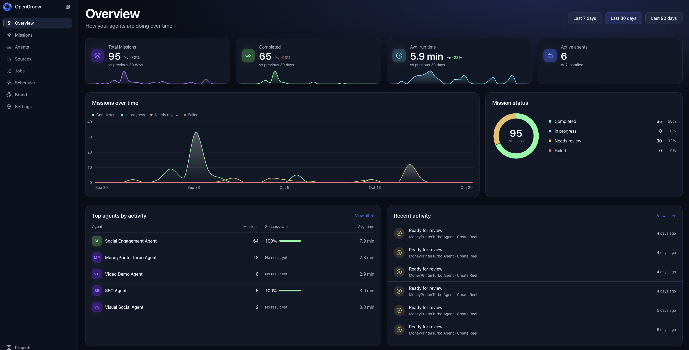

# OpenGroow

**Your AI agents. One workspace. Endless possibilities.**

OpenGroow is an open-source platform to build, deploy, and manage teams of AI agents from a single dashboard.

Create projects, install ready-made agents, connect MCP tools, and automate workflows. Your agents run on [OpenClaw](https://github.com/openclaw/openclaw), while OpenGroow handles orchestration, scheduling, and management.

**Open source · Self-hosted · Powered by OpenClaw**

---



---

## What you can do

- **Manage AI agents** — Install agents from reusable Templates, configure their capabilities, and give each one a dedicated workspace.
- **Run missions** — Assign tasks to agents, monitor execution, review results, and approve content before publishing.
- **Automate workflows** — Schedule recurring missions and let agents work automatically.
- **Discover opportunities** — Collect, evaluate, and route information from different sources into actionable workflows.
- **Connect any MCP server** — Extend your agents with external tools, APIs, and integrations.
- **Manage multiple projects** — Keep agents, configurations, and workflows organized in independent projects.

## How it works

OpenGroow organizes your AI workforce around three concepts:

**Projects** are dedicated environments for your agents and workflows.

**Agents** are installed from reusable Templates. Each agent has its own workspace, instructions, and MCP tools.

**Missions** are tasks executed by agents, either manually or automatically through Schedules.

Your agents run on OpenClaw. OpenGroow provides the interface and orchestration layer to manage them.

## Quick start

### Requirements

- [Node.js](https://nodejs.org)
- [pnpm](https://pnpm.io)
- [Docker](https://www.docker.com) (running)

### Installation

```bash
git clone https://github.com/OpenGroow/OpenGroow.git
cd OpenGroow
pnpm install
cp .env.example .env
```

Configure the required environment variables in `.env`, then start OpenGroow:

```bash
pnpm dev
```

Open **http://localhost:3912** in your browser.

Create an account, click **Create New Project**, and start adding agents.

To stop the development environment, press `Ctrl+C`. Run `pnpm dev:down` to stop its Docker containers.

Provider credentials used by your agents are configured per Project in the dashboard, not in `.env`.

For deployment using published Docker images, see the [Self-hosting guide](docs/START.md).

> **Security note:** Some deployment modes require access to the Docker socket to provision project environments. This grants powerful host-level privileges. Review the deployment security considerations before exposing OpenGroow to untrusted users.

## Built on OpenClaw

OpenGroow uses [OpenClaw](https://github.com/openclaw/openclaw) as its agent runtime.

Instead of managing agents and their environments manually, OpenGroow provides a unified interface for projects, templates, missions, schedules, and execution monitoring.

Agent capabilities can be extended through MCP servers, and developers can create and distribute their own Templates.

## GroowHub — Extend your AI workforce

[GroowHub](https://github.com/OpenGroow/groowhub) is the Template hub for OpenGroow.

Browse and install ready-made Templates to give your agents new capabilities, workflows, and integrations without building everything from scratch.

Templates follow a ClawHub-compatible package format, making it easier to build, share, and reuse agent capabilities within the OpenGroow ecosystem.

You can install Templates from GroowHub directly into your Projects or create and distribute your own.

**Install. Extend. Automate.**

## Contributing

OpenGroow is an open-source project. Contributions, bug reports, and ideas are welcome.

You can help by reporting issues, improving documentation, building Templates, or contributing code.

Explore the [GitHub Issues](https://github.com/OpenGroow/OpenGroow/issues) to get started.

## License

OpenGroow is licensed under [AGPL-3.0-only](LICENSE).
